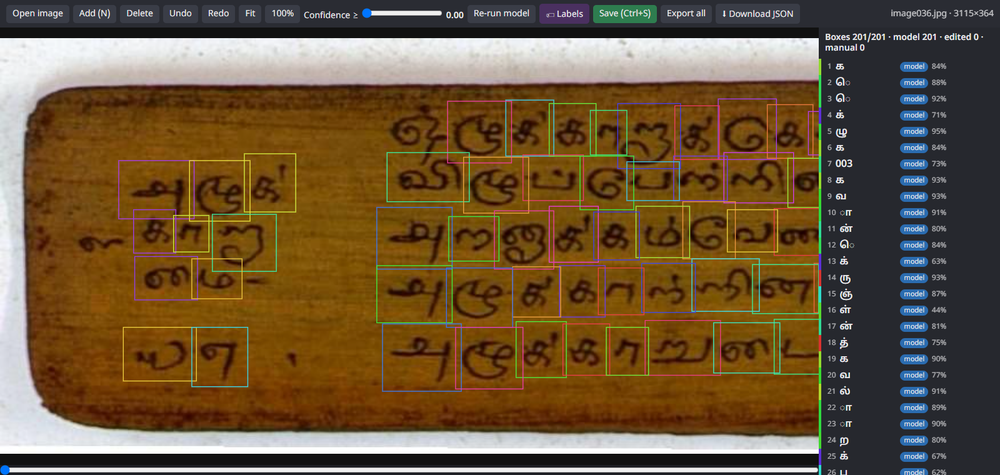
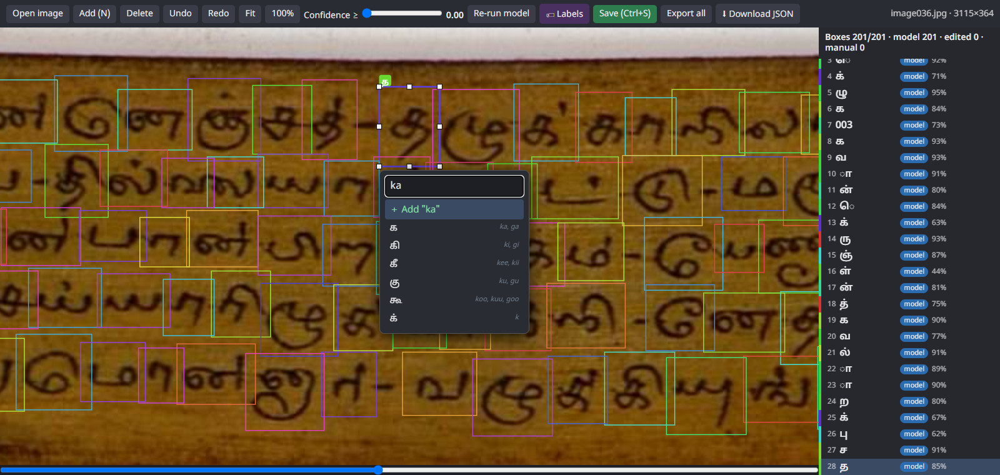
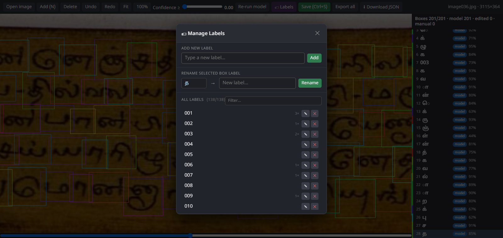
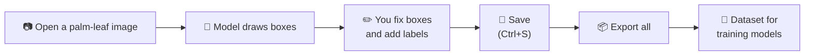

<div align="center">

# 🌴 ஓலைச்சுவடி · Palm-Leaf Annotator

**Draw, fix and label Tamil characters on palm-leaf manuscripts, with an AI model doing the first pass.**




</div>

---

## 📑 Contents

- [What it does](#-what-it-does)
- [How it works](#-how-it-works)
- [Installation](#-installation)
- [Running the tool](#-running-the-tool)
- [Annotating step by step](#-annotating-step-by-step)
- [Keyboard and mouse](#-keyboard-and-mouse)
- [Where your files go](#-where-your-files-go)
- [Troubleshooting](#-troubleshooting)
- [For developers](#-for-developers)
- [License](#-license)

---

## ✨ What it does

Labelling every character on a palm leaf by hand is slow. This tool speeds it up:

| | |
|---|---|
| 🤖 **AI suggests the boxes** | A YOLO model draws a box around every character when you open an image. |
| ✏️ **You fix them** | Move, resize, add or delete boxes with the mouse or keyboard. Undo and redo work everywhere. |
| 🔤 **Easy Tamil labels** | Search labels in Tamil, or type English sounds like `ka`, `tha` or `zh` to find க, த, ழ. |
| 🎚️ **Confidence filter** | A slider hides weak guesses from the model. |
| 🏷️ **Label manager** | Add, rename and delete labels, and see how often each one is used. |
| 📦 **One-click export** | Get a COCO-style JSON dataset plus a ZIP of character crops, one folder per label. |
| 📜 **Made for long leaves** | Zoom, pan and side-scroll easily on very wide images. |

<table>
<tr>
<td width="50%"><br><sub><b>Label picker:</b> typing <code>ka</code> finds க, கி, கீ, கு …</sub></td>
<td width="50%"><br><sub><b>Label manager:</b> add, rename or delete labels</sub></td>
</tr>
</table>

---

## 🔄 How it works



The tool runs **on your own computer**. A small Python server (`app.py`) runs the model and saves
files, and your web browser shows the editor. Nothing is uploaded to the internet.

---

## 🛠️ Installation

You only need to do this **once**.

**1. Install Python 3.10 or newer** from [python.org](https://www.python.org/downloads/).
On Windows, tick **"Add Python to PATH"** during setup.

**2. Download this project.** Either click **Code → Download ZIP** on GitHub and unzip it, or run:

```bash
git clone https://github.com/AshvittaS/Olaisuvadi-Dataset.git
cd Olaisuvadi-Dataset
```

**3. Install the requirements:**

```bash
python -m venv .venv
```

```bash
# Windows
.venv\Scripts\activate
# macOS / Linux
source .venv/bin/activate
```

```bash
pip install -r requirements.txt
```

> ⏳ This downloads PyTorch, so the first install can take several minutes.

**4. (Optional) Add the AI model.** Put your trained model file at `weights/best.pt`.
Model files aren't stored in this repository. Without one, the tool still works and you draw the boxes yourself.

---

## ▶️ Running the tool

### Windows: the easy way

Double-click **`start.bat`**. The first time, it sets everything up automatically. After that it just starts the tool.

### Any system

```bash
# activate the environment first (see Installation, step 3)
python -m uvicorn app:app --reload
```

Then open **<http://127.0.0.1:8000>** in your browser.

To stop the tool, press **Ctrl + C** in the terminal window.

---

## 📝 Annotating step by step

1. **Open an image.** Click **Open image** or drag a `.jpg` / `.png` onto the page.
   The model draws boxes around the characters.
2. **Check the boxes.**
   - Wrong size or position: drag the box, or pull its corner handles.
   - Missing a character: press **N**, then drag to draw a new box.
   - Extra box: select it and press **Delete**.
3. **Add labels.** Double-click a box (or select it and press **Enter**), then type a Tamil letter
   or its English sound and choose it from the list. Boxes the model couldn't label show **`?`**.
4. **Save.** Press **Ctrl + S**. If you open the same image again later, your work loads automatically.
   Click **Re-run model** to start again from fresh model predictions.
5. **Export.** When you've finished several images, click **Export all** to get the full dataset.

> 💡 **Tip:** boxes hidden by the confidence slider are **not saved**. Move the slider back to `0.00`
> if you want to keep every box.

---

## ⌨️ Keyboard and mouse

| Action | Keys / mouse |
|---|---|
| Draw a new box | <kbd>N</kbd> |
| Delete selected box | <kbd>Delete</kbd> or <kbd>Backspace</kbd> |
| Set a label | <kbd>Enter</kbd> or double-click |
| Deselect / close the label list | <kbd>Esc</kbd> |
| Move a box slightly | Arrow keys (hold <kbd>Shift</kbd> to move 10 px) |
| Undo / redo | <kbd>Ctrl</kbd>+<kbd>Z</kbd> / <kbd>Ctrl</kbd>+<kbd>Y</kbd> |
| Save | <kbd>Ctrl</kbd>+<kbd>S</kbd> |
| Zoom | Mouse wheel |
| Pan | Hold <kbd>Space</kbd> and drag, or drag with the middle mouse button |
| Scroll sideways | <kbd>Shift</kbd> + mouse wheel, or the slider at the bottom |

---

## 📂 Where your files go

Everything is saved inside the project folder, on your computer:

| What | Where |
|---|---|
| Saved images | `dataset/images/<name>.jpg` |
| Saved boxes and labels | `dataset/annotations/<name>.json` |
| Full dataset (from **Export all**) | `exports/merged_dataset.json` |
| Character crops (from **Export all**) | `exports/crops_all_labeled.zip` |
| Single-image JSON (from **⬇ Download JSON**) | `annotations/<name>.json` |
| List of labels | `labels.json` |

These data folders are **never uploaded to GitHub**. They're listed in `.gitignore`.

<details>
<summary><b>Example annotation file</b> (click to expand)</summary>

```json
{
  "image": "image036.jpg",
  "width": 3115,
  "height": 364,
  "bbox_format": "[x, y, width, height]",
  "annotations": [
    { "id": 1, "bbox": [2530, 43, 53, 52], "label": "க", "source": "model", "confidence": 0.84 }
  ]
}
```

- `bbox`: the box position in image pixels, as `[x, y, width, height]`.
- `source`: `model` = untouched prediction, `edited` = a prediction you changed, `manual` = a box you drew.
- `confidence`: how sure the model was (only kept for untouched predictions).
- Boxes are ordered top-to-bottom, then left-to-right.

The **merged export** uses a COCO-like layout: `images`, `annotations` (with `bbox`, `area`, `label`
and `source`), one `character` category, and a `folders` list linking each label to its crops.

</details>

---

## 🩺 Troubleshooting

<details>
<summary><b>"An Application Control policy has blocked this file" (Windows)</b></summary>

Windows Smart App Control blocks `uvicorn.exe`. Start the tool with
`python -m uvicorn app:app --reload` instead, or use `start.bat`.
</details>

<details>
<summary><b>"running scripts is disabled on this system" when activating</b></summary>

Run this once in PowerShell, then try again:

```powershell
Set-ExecutionPolicy -Scope CurrentUser RemoteSigned
```
</details>

<details>
<summary><b>An orange bar says "weights/best.pt not found"</b></summary>

The model file is missing, so no boxes are suggested. Put your model at `weights/best.pt`,
or keep going and draw the boxes yourself.
</details>

<details>
<summary><b>Fewer boxes than expected</b></summary>

- Check the **Confidence** slider. Anything below its value is hidden.
- If the image was saved before, the tool loads your saved boxes instead of running the model.
  Click **Re-run model** to get fresh predictions.
- Results can differ slightly between versions of `ultralytics`. Use the version you trained with.
</details>

<details>
<summary><b>"Port 8000 is already in use"</b></summary>

Start the tool on another port, for example `python -m uvicorn app:app --port 8001`,
and open <http://127.0.0.1:8001>.
</details>

---

## 👩‍💻 For developers

```
app.py            FastAPI server: predict, save, labels, export
model.py          The only file that knows about the model
check_model.py    Quick test that weights/best.pt loads and predicts
labels.json       Tamil label list used by the picker
start.bat         One-click launcher for Windows
static/           The editor (index.html, app.js, style.css)
weights/          Put best.pt here (not tracked by git)
docs/images/      Screenshots for this README
```

**Using a different model.** All model code is in [`model.py`](model.py). Rewrite `predict()`
and return the same format, with coordinates in original-image pixels:

```python
[{"bbox": [x, y, w, h], "label": "க", "confidence": 0.93}, ...]
```

Classes named `unknown` or `character` are treated as "no label yet" and shown as `?`.

**Testing the model** (looks for an image in `dataset/images/` or `_staging/`):

```bash
python check_model.py
```

---

## 📄 License

Released under the [MIT License](LICENSE). You can use, change and share this code freely,
as long as you keep the copyright notice.
